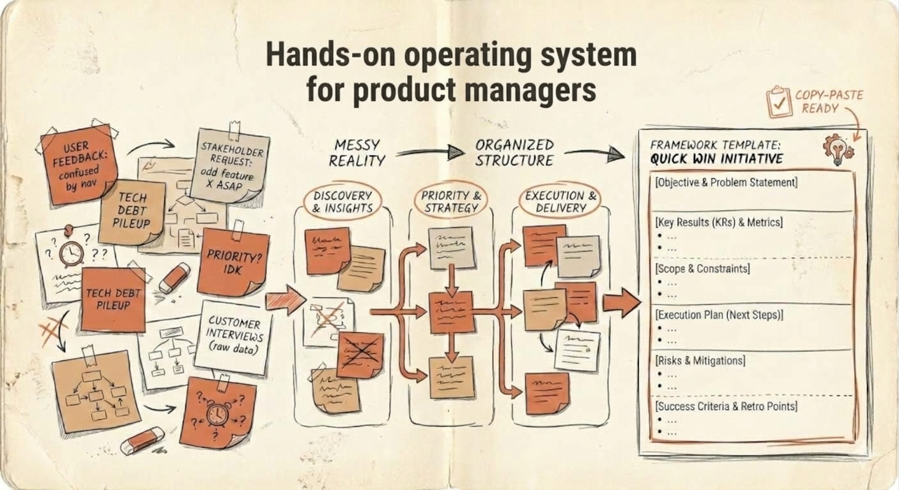

# PM Brain as Code

[](https://creativecommons.org/licenses/by-nc-sa/4.0/) [](https://github.com/andreaskelm/pm-brain) [](https://github.com/andreaskelm/pm-brain/fork)

**Getting started:** [Setup in this README](#getting-started) · [Full onboarding](docs/setup.md) · [Agent wiring](docs/platform-setup.md)

PM Brain is a git repo that works as your external product management brain: knowledge, reasoning, and decisions as plain markdown on your machine, versioned like code. It comes with an AI coach that challenges your thinking by default, so you can think clearly under pressure and not only after the meeting, when it is too late.

<p align="center"></p>

You have probably felt this before:

- *"Sprint planning starts in 30 minutes and we still do not have a clear prioritization call."*
- *"Leadership wants the strategy doc by EOD and I am still stitching context from Confluence, Jira, old email, and town-hall slides from four months ago."*
- *"A stakeholder flips right before go-live, and we postpone or kill launch over something we could have pressure-tested upfront."*

The gap is familiar: you know the frameworks, but theory does not walk into the room with you when the clock is running. PM Brain bridges **PM theory and tactical daily execution** in those moments: your context in git, workflows when you need structure, and a coach that challenges you before you default to the easy call.

Product work is messy. A lot of the time it is brain soup. Context is scattered across Notion, Linear, Slack, dashboards, and slides, while the part that decides outcomes (why you killed the other option, what you assumed, what would make you reopen the call) lives in your head until the next meeting wipes the buffer. Six weeks later nobody can reconstruct the decision because it was never explicit in one place.

The markdown folders give that a home. Company context lives in `1-Context/`. Active work lives in `3-Work/` at three sizes: a sharp bit from today (`signals/`), a small bet you are testing (`hypotheses/`), and an initiative narrative. Insights that do not belong to a bet yet live in `4-Research/`. Scored calls and weekly drift live in `5-Growth/decisions.md` and the weekly notes. A coaching layer helps you apply product sense, second-order thinking, and risk identification when you are stuck, on the big strategy fork and on the small call that unblocks the day. Filing a bit waits until you have said what it is. **Latest commit = source of truth** for knowledge and decisions in this repo; git history shows how your thinking evolved.

Jira, Confluence, and Figma stay where they are, and you link out to them. You still own the thinking and the decisions. The agent challenges, structures, and remembers with you.

I built this for my own work and use it daily in a real organization. It has been through dozens of iterations because real use kept breaking my assumptions about what PMs need. The part I use most is the organizational survival layer (stakeholder profiles, power maps, and political landscape docs), because frameworks rarely name what actually kills launches.

---

## What it actually is

Most AI PM tools speed up execution: emails, slides, tickets, artifacts. PM Brain is not that. It is built for ambiguous, politically loaded product work — figuring out what is worth doing and getting people to agree — and for making intent, evidence, and calls durable before and while you execute, from your own context files and past decisions.

### A coach that challenges your thinking

The PM Brain Coach starts with a braindump when the problem is still forming, then asks a few uncomfortable questions before suggesting structure. It stays in `product_sense` until the [braindump floor](system/coaching/braindump.md#sufficiency-criteria) is met for real, not performative:

- Your assumptions are named
- You have separated what you know from what you are guessing
- At least one risk or second-order effect is on the table
- At least one uncomfortable thought challenges the plan

Only then does it route to a skill in `.claude/skills/`, a workflow with templates and quality criteria. Along the way it names biases lightly, pressure-tests hypotheses ("what would be the first signal you're wrong?"), and keeps the judgment call with you.

When you ask for a doc directly ("Write the PRD," "Draft OKRs"), the coach runs a short preflight (why this, what you know versus what you guess, who it is for), then moves to `execution_mode` and the matching skill. The preflight exists to stop you shipping a doc that papers over a hole you already sensed in the room. The repo loads the right context, so you do not re-paste the company into every chat.

### An organizational survival system

You build stakeholder avatars with goals, fears, incentives, real phrases, and historical behavior. You map power structures, alliances, fault lines, and veto holders. You log the "Red Weddings" so you do not walk into the same one twice. The agent can answer "What would my manager say about this?" with both an out-loud reaction and an inner monologue. Details are in [The organizational survival layer](#the-organizational-survival-layer) below.

### A learning and growth system

Hindsight makes everyone sound calibrated, so it is hard to tell whether your judgment is improving. PM Brain treats product sense as a skill you practice with evidence. Calibration means that when you say 70%, you are right about seven times out of ten.

- [decisions.md](5-Growth/decisions.md): log calls with confidence and reopen triggers before outcomes land, and score calibration when you know the result ([background](2-Methods/1-Foundations/1-Mental-Models/1-Decision-Making/8-calibration.md))
- [weekly/](5-Growth/weekly/README.md): one short note per week on live assumptions, drift, and what you are avoiding. The weekly review skill drafts it and you correct it.
- Optional depth: monthly synthesis, post-project reflection, and 1:1-ready narrative in [2-Methods/1-Foundations/3-Self-Reflection/](2-Methods/1-Foundations/3-Self-Reflection/README.md). Research insights stay in [4-Research/](4-Research/README.md), not in Growth.

The folder is deliberately small so you actually use it. Rationale: [5-Growth/README.md](5-Growth/README.md).

### Context that loads when you need it

The wake table in [AGENTS.md](AGENTS.md#where-things-live-wake-on-demand) tells the coach what to load when (company context, initiatives, research, stakeholders), so it does not pull the whole repo into every turn. This is an instruction to the agent, not a platform lock. It holds when your tool loads `AGENTS.md` and the model follows it. For long sessions, capture durable state in `5-Growth/` or `3-Work/[initiative]/` ([`system/ORCHESTRATION.md`](system/ORCHESTRATION.md)).

### Platform-agnostic

Cursor, Claude Code, VS Code Copilot, Claude.ai, ChatGPT, or any tool that can read repo files. Bootstrap with `AGENTS.md` (plus `USER.md` when present). Workflows live in `.claude/skills/` and delegation in `.claude/agents/`. Routing is in `system/ORCHESTRATION.md` at state entry. Wiring: [docs/platform-setup.md](docs/platform-setup.md) (model tiers, hooks, live evals).

---

## How the agent works

The PM Brain Coach runs as a lightweight state machine in `system/ORCHESTRATION.md`:

| Mode | When |
|------|------|
| `product_sense` | The default for product, strategy, discovery, stakeholders, and org dynamics. Stays until the four criteria in [braindump.md](system/coaching/braindump.md) are met. |
| `execution_mode` | Enough thinking, or an explicit doc request (preflight first). Loads the matching `.claude/skills/` workflow. |
| `meta_reflection` | After substantial decisions or discovery: forecasts, learnings, and patterns go in `5-Growth/`. |
| `conversation` | Navigation, repo questions, and lightweight topics. |

State transitions and loading rules: [`system/ORCHESTRATION.md`](system/ORCHESTRATION.md). Maintainer detail: [`docs/architecture.md`](docs/architecture.md).

---

## Skills and subagents

Skills (`.claude/skills/`) own workflows: capture (file a sharp bit), PRD, OKR, roadmap, prioritize, opportunity assessment, politics-coach, weekly review, and more. [2-Methods/](2-Methods/README.md) is reference depth (mental models, guides); the coach routes to skills, not raw template files. Pick a workflow from [2-Methods/0-index.md](2-Methods/0-index.md), or invoke `/skill-name` where your platform supports it. To use them in another repo, see [Getting started](#getting-started).

Subagents (`.claude/agents/`) handle mechanical or independent work: `context-scout` (repo scan), `artifact-reviewer` (quality checks without grading your own draft), and `stakeholder-simulator` (avatar-based reactions). Coaching and judgment calls stay in the main thread. See [AGENTS.md](AGENTS.md) under Delegation.

---

## System structure

```text
pm-brain/
|-- AGENTS.md                  # Bootstrap: persona, voice, wake table
|-- USER.md                    # Your personal context
|-- .claude/skills/            # Workflows (PRD, OKR, prioritize, …)
|-- .claude/agents/            # Subagents (scout, reviewer, simulator)
|-- system/                    # Orchestration, coaching, evals
|-- 1-Context/                 # Vision, strategy, stakeholders, org survival
|-- 2-Methods/                 # Reference: mental models, guides (0-index → skills)
|-- 3-Work/                    # Signals, small hypotheses, initiatives
|-- 4-Research/                # Research artifacts
|-- 5-Growth/                  # decisions.md + weekly/
|-- docs/                      # Setup, principles, architecture (docs/README.md)
+-- .cursor/                   # Hooks (Cursor)
+-- .github/                   # CI workflows
```

When your reasoning shifts, git history is the audit trail — not another stale page nobody updates. Maintainer architecture: [`docs/architecture.md`](docs/architecture.md).

---

## The organizational survival layer

Most PM playbooks skip this.

`1-Context/1.1-Stakeholder-Avatars/` holds your cast, one file per person:

- Explicit and implicit goals
- Fears and incentives
- Real phrases they use
- Historical behavior and tells

The `politics-coach` skill uses these to simulate reactions: the out-loud response, the inner monologue, the top objections, and how to de-risk for that person specifically.

`1-Context/1.2-Organization-Survival/` maps the system:

- Power map: who formally owns decisions, who actually decides, and who can quietly veto
- Political landscape: alliances, fault lines, protected systems, and narrative landmines
- Stakeholder games: recurring patterns and how to work with them
- Coalitions and timing: what must be sequenced before big moves
- Red flags and history: the "Red Weddings" log

After a political incident or a "we should have seen this coming" moment, update these documents.

---

## Evaluation system

PM Brain has two eval layers, and their names overlap:

- Artifact QQC (methods "Level 1"). Quick Quality Checks in key frameworks (OKRs, roadmaps, PRDs, opportunity assessments, North Star, one-pagers). They run while you create artifacts and catch thin problem definitions, missing risks, and weak metrics. Rules: [system/EVALUATION.md](system/EVALUATION.md).
- Harness tiers L0–L4 (`system/evals/`). Repo health (L0), rubric regression (L1), behavior scenarios (L2), human review (L3), and in-turn write hooks (L4). Use them to check whether the agent followed the golden rule, stayed in `product_sense` long enough, and surfaced meaningful risks.

Overview: [system/evals/README.md](system/evals/README.md). CI and local commands: [docs/evals-fork.md](docs/evals-fork.md).

---

## Getting started

You can use PM Brain in an AI chat tool or in an IDE.

### Option 1: AI chat tools (Claude.ai, ChatGPT, Gemini, etc.)

1. Browse to the folder you need in this repo.
2. Copy [`AGENTS.md`](AGENTS.md) (coach behavior), [`USER.md`](USER.md) if you personalize it, plus any relevant `README` + framework + template files.
3. Paste them into your AI chat with a prompt like:
   > "Here is my PM system. First, help me braindump my thoughts on **[topic]**. Challenge my assumptions and help me think before we structure anything."
4. Save that context in your AI tool's project or workspace feature for reuse.

### Option 2: IDE tools (Cursor, VS Code + Copilot, Claude Code)

1. Clone or fork (fork if you will add company-specific context):

   ```bash
   git clone https://github.com/andreaskelm/pm-brain.git
   cd pm-brain
   ```

2. Follow [`docs/setup.md`](docs/setup.md) for Company Context, privacy mode, and the optional `5-Growth/` setup.
3. Wire the agent with [`docs/platform-setup.md`](docs/platform-setup.md): the `AGENTS.md` bootstrap, skills, and model tiers.
4. Open the repo and start a chat. Say what you are working on ("I am stuck on prioritization," "Help me think through this feature," "I need to write a PRD"). The agent guides you and signals when it moves from exploring to structuring.

To use the skills in another repo (Cursor): `npx skills add andreaskelm/pm-brain`. It installs `.claude/skills/` from upstream.

Who it is for, a typical day, and upkeep cadence are in [`docs/setup.md`](docs/setup.md#who-its-for).

---

## Start here (quick navigation)

- Setup and install: [`docs/setup.md`](docs/setup.md)
- Agent wiring (AGENTS.md, skills per platform): [`docs/platform-setup.md`](docs/platform-setup.md)
- All human docs: [`docs/README.md`](docs/README.md)
- Architecture: [`docs/architecture.md`](docs/architecture.md)
- Design principles and maintenance: [`docs/principles.md`](docs/principles.md)
- Legacy folder migration: [`docs/legacy-migration.md`](docs/legacy-migration.md)
- Think through a product decision: [`system/coaching/README.md`](system/coaching/README.md)
- I know the workflow I need (PRD, OKR, roadmap, …): [`2-Methods/0-index.md`](2-Methods/0-index.md), then `.claude/skills/`
- Run or inspect evals: [`system/evals/README.md`](system/evals/README.md) (CI: [`docs/evals-fork.md`](docs/evals-fork.md))
- Golden rule and sufficiency criteria: [`system/coaching/braindump.md`](system/coaching/braindump.md)

---

## Contributing

- Fork privately for real company context. After forking, tell the PM Brain agent your mode (public, private, or team), and it helps configure `.gitignore` and flag sensitive files already tracked. See [`docs/setup.md`](docs/setup.md), Step 3.
- Contribute back to the public template: frameworks, guides, clearer patterns. Keep examples generic and remove proprietary detail.

Follow the existing folder and naming patterns, write clear commit messages, and keep changes small and reviewable.

---

## Created by [Andreas Kelm](https://github.com/andreaskelm)

Star the repo if it is useful, and fork it to make it yours.

---

## Credits and license

Frameworks build on the work of product management thought leaders. See [`docs/credits.md`](docs/credits.md).

Licensed under CC BY-NC-SA 4.0: view, use, modify, and share with attribution for non-commercial purposes. See [`LICENSE`](LICENSE).
